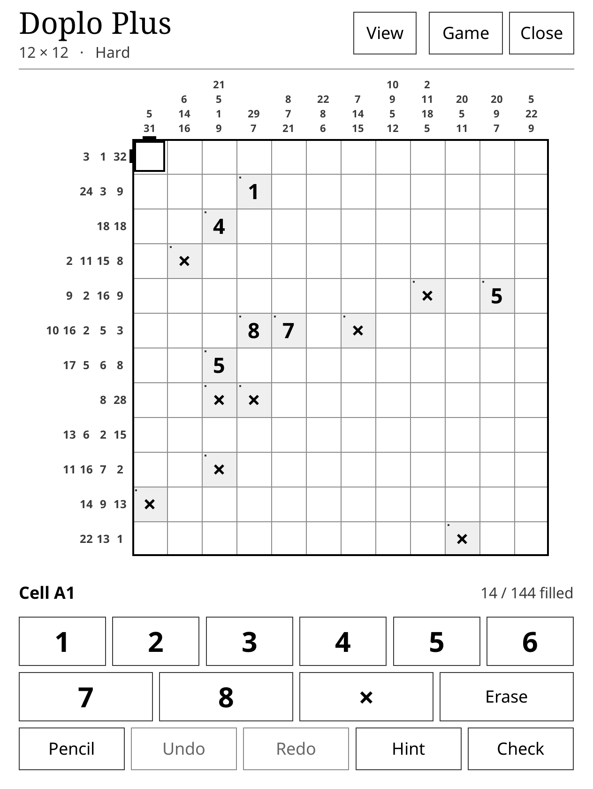

# Doplo voor KOReader

Speel Doplo en Doplo Plus offline op een e-reader met KOReader. **Tools → Doplo** opent onmiddellijk een 5×5-puzzel of hervat je laatste spel. De plugin is geschreven in Lua. Een tik op het bord en een tik op het invoerveld volstaan voor een zet.

## Installeren

1. Sluit KOReader af en verbind je Kobo via USB met je computer.
2. Pak **doplo-v1.0.0.koplugin.zip** uit en kopieer de map **doplo.koplugin** naar **.adds/koreader/plugins/**. Het volledige pad op de Kobo is `.adds/koreader/plugins/doplo.koplugin/main.lua`. Gebruik de optie om verborgen bestanden te tonen als de map `.adds` verborgen is.
3. Werp de Kobo veilig uit. Start KOReader en open **Tools → Doplo** via het bovenmenu. Het menu is beschikbaar in de bestandsbrowser en in een geopend boek.

Je kunt ook de map `doplo.koplugin` rechtstreeks uit deze repository kopiëren. Op een andere KOReader-installatie gebruik je de bijbehorende `plugins`-map. Als Doplo eerder is uitgeschakeld, vink je de plugin aan onder **Tools → More tools → Plugin management** en herstart je KOReader.

## Spelen

| Actie | Bediening |
| --- | --- |
| Een zet doen | Tik op een vak, daarna op een cijfer of **×**. **Erase** maakt een bewerkbaar vak leeg en wist de notities. Vaste waarden hebben een grijze achtergrond en een hoekstip. |
| Kandidaten bijhouden | Zet **Pencil** aan. Tik cijfers of een kruisje aan om een kandidaat te zetten of te verwijderen. Zet **Pencil** uit voor een definitieve invoer. |
| Meer ruimte | Houd een vak ingedrukt voor een groot toetsenblok met de aanwijzingen van de rij en kolom. Bij Plus vergroot **View** een deel van het bord. |
| Door het bord bewegen | Tik op het doelvak. De bladerknoppen verplaatsen de selectie in leesvolgorde, met doorloop aan het begin en einde. Deze toewijzingen horen bij het geopende spelvenster. |
| Een zet terugnemen | **Undo** en **Redo** bewaren ook de potloodnotities. Na een nieuwe zet vervalt het redo-pad. |
| Controleren | **Check** meldt de eerste gevonden regelfout. Bij een gedeeltelijk ingevuld bord kan het ook een invoer aanwijzen die de unieke oplossing uitsluit. Een volledig bord krijgt pas de status **Solved** na controle van alle lijnen, sommen en vaste waarden. |
| Een hint gebruiken | **Hint** toont een cel, waarde en reden. **Place value** past de zet toe. Bij een strijdige invoer verwijst de hint naar **Check**. |
| De oplossing bekijken | **Game → Show solution** opent een alleen-lezen weergave. **Return** brengt je terug naar je eigen bord. |
| Een ander spel openen | **Game → New puzzle** kiest variant, formaat en niveau. **Game → Saved puzzles** toont eerdere spellen, hun voortgang en het tijdstip van de laatste wijziging. |

## Spelregels en formaten

Elke rij en kolom bevat elk toegelaten cijfer precies één keer en het aangegeven aantal kruisjes.

| Variant | Formaat | Kruisjes | Cijfers | Randaanwijzingen |
| --- | --- | --- | --- | --- |
| Doplo | 5×5 | 2 | 1–3 | Eén som tussen beide kruisjes |
| Doplo | 6×6 | 2 | 1–4 | Eén som tussen beide kruisjes |
| Doplo Plus | 7×7 | 2 | 1–5 | Eén som per aaneengesloten cijfergroep |
| Doplo Plus | 10×10 | 3 | 1–7 | Eén som per aaneengesloten cijfergroep |
| Doplo Plus · Extended | 12×12 | 4 | 1–8 | Dezelfde groepssommen op een groter rooster |

Bij **Doplo** geeft `× 1 2 3 ×` de aanwijzing 6 en `1 × 2 3 ×` de aanwijzing 5. Kruisjes naast elkaar geven 0. [Uitgeversregels voor Doplo](https://www.kueng-raetsel.ch/anleitungen/)

Bij **Doplo Plus** lees je de cijfergroepen van links naar rechts of van boven naar beneden. Groepen aan de buitenrand tellen mee. De reeks `1 2 × 3 × 4 5` krijgt **3 · 3 · 9**. Voor `× × 2 1 5 4 3` staat er alleen **15**. De uitgever beschrijft 7×7 en 10×10. De plugin biedt de gevraagde 12×12 met vier kruisjes als eigen uitbreiding. [Uitgeversregels voor Doplo Plus, gedrukte p. 40](https://www.kueng-raetsel.ch/hefte/Taschen-Logik-Mix.pdf#page=13)

## Beelden uit KOReader

Dit zijn opnamen van de Linux/SDL-framebuffer. Open de bestanden voor de oorspronkelijke resolutie.

| Doplo 5×5 met notities | Doplo Plus 12×12 |
| --- | --- |
|  |  |

[Vergrote sectie van de 12×12-puzzel](docs/screens/doplo-plus-zoom.png) · [Liggend scherm](docs/screens/landscape.png)

## Generatie, moeilijkheid en opslag

De generator maakt een ingevuld rooster, leidt de aanwijzingen af en kan vaste startwaarden toevoegen. De solver telt oplossingen tot een tweede is gevonden of de zoekruimte is uitgeput. Alleen een rooster met precies één oplossing én het gekozen niveau wordt aangeboden. De zwart-witweergave gebruikt gerichte verversingen voor selectie, waarde en bediening.

Bij de niveau-indeling telt een ronde als één gelijktijdige beperking vanuit alle rijen en kolommen. Het gaat om de rondes waarin kandidaten verdwijnen. Easy gebruikt tot en met drie rondes, Medium vier of vijf en Hard zes tot en met acht. Expert vergt minstens negen rondes of een splitsing in het zoekproces. Deze indeling schat de moeilijkheid vanuit de solver. De ervaring van een speler kan verschillen.

Generatie geeft regelmatig de controle terug aan KOReader. Met **Cancel** houd je het huidige spel. Met **Play ready puzzle** speel je direct een vooraf gecontroleerde puzzel op het gekozen formaat en niveau. Na een wachttijd van ongeveer vier seconden, of na 80 pogingen, kiest Doplo automatisch uit dezelfde voorraad. Voor elk van de twintig combinaties zijn er twaalf verschillende puzzels. Na twaalf voorraadpuzzels in dezelfde combinatie begint de cyclus opnieuw. De generator kan daarnaast nieuwe puzzels maken.

Na elke waarde, notitie, undo en redo schrijft Doplo de voortgang naar een eigen bestand per spel. De opslag wisselt tussen twee versies. Bij heropenen kiest Doplo de nieuwste leesbare, geldige versie. Ook het geselecteerde vak en de potloodstand worden bewaard bij afsluiten of slaapstand. Een reservekopie bestaat uit `settings/doplo-games/` en `settings/doplo.lua` in het KOReader-profiel. Het profiel staat op een gangbare Kobo-installatie in `.adds/koreader/`.

## Ontwikkeling en verificatie

| Onderdeel | Locatie in de plugin |
| --- | --- |
| Menuregistratie, spellen openen en hervatten | `main.lua` |
| Regels, validatie en speltoestand | `doplo/model.lua`, `doplo/game.lua` |
| Lijnanalyse, zoeken en hints | `doplo/line.lua`, `doplo/solver.lua` |
| Roostergeneratie en niveau-indeling | `doplo/generator.lua`, `doplo/difficulty.lua` |
| Gecontroleerde puzzelvoorraad | `doplo/bank.lua` |
| KOReader-bediening, indeling en tekenen | `doplo/screen.lua`, `doplo/layout.lua`, `doplo/paint.lua` |
| Opslag en herstel | `doplo/store.lua` |

De beslisprocedure voor één lijn onthoudt de positie, de gebruikte cijfers en de huidige som of Plus-groep. Ze geeft de mogelijke waarden voor elk vak terug. De bordsolver kruist die mogelijkheden van rijen en kolommen en herhaalt dat tot er geen kandidaten meer verdwijnen. Bij een resterende keuze probeert hij het vak met de minste kandidaten. Het controleren van een voltooid bord is afzonderlijk geïmplementeerd. De generator gebruikt permutaties van cyclische Latijnse vierkanten en bestrijkt daarmee een deel van alle geldige eindroosters.

Met deze opdrachten voer je vanuit de hoofdmap de tests uit en bouw je de installatie-ZIP.

```sh
luajit tests/engine.lua
python3 tools/package.py --out /tmp/doplo-release
python3 tools/test_koreader.py /path/to/koreader --zip /tmp/doplo-release/doplo-v1.0.0.koplugin.zip
```

Een fysieke Kobo was voor deze release niet beschikbaar. De volledige route van installeren, spelen, bewaren en heropenen is op twee Linux/SDL-uitgaven van KOReader getest. Het verversingsgedrag van een fysiek e-inkpaneel en de elektrische bladerknoppen zijn nog onbeproefd. De bediening is ontworpen voor touchapparaten. De undo-geschiedenis omvat de laatste 200 wijzigingen per puzzel. [Testinstructies en resultaten](docs/VERIFICATION.md)

## Licentie

AGPL-3.0-or-later. Alle meegeleverde puzzels komen uit de eigen generator. [Volledige licentie](LICENSE) · [Bronnen en hergebruik](doplo.koplugin/SOURCES.md)

## Git-repository uit de bron-ZIP

De bron-ZIP bevat naast de uitgepakte bestanden een Git-bundel met de branch `main` en de releasetag `v1.0.0`. Vanuit de uitgepakte hoofdmap maak je een lokale kloon met `git clone repository.bundle ../doplo-git`.
