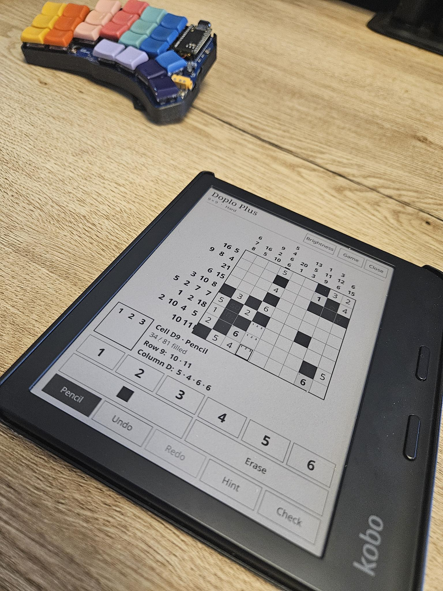
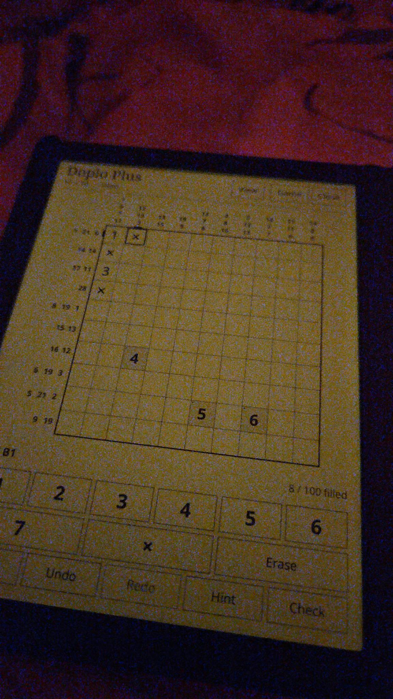
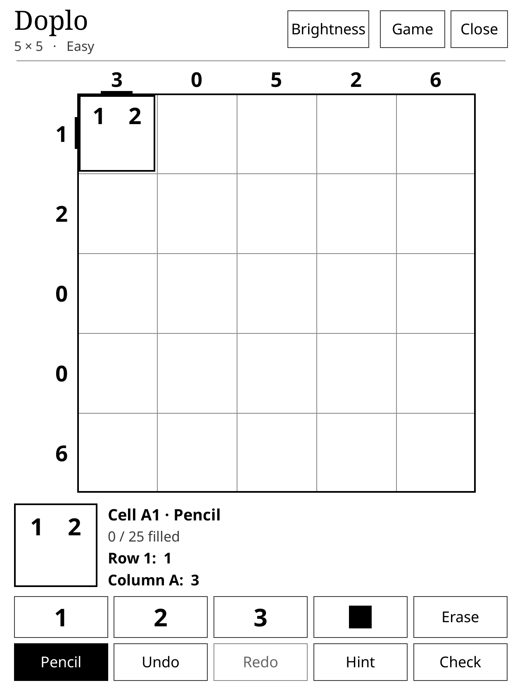
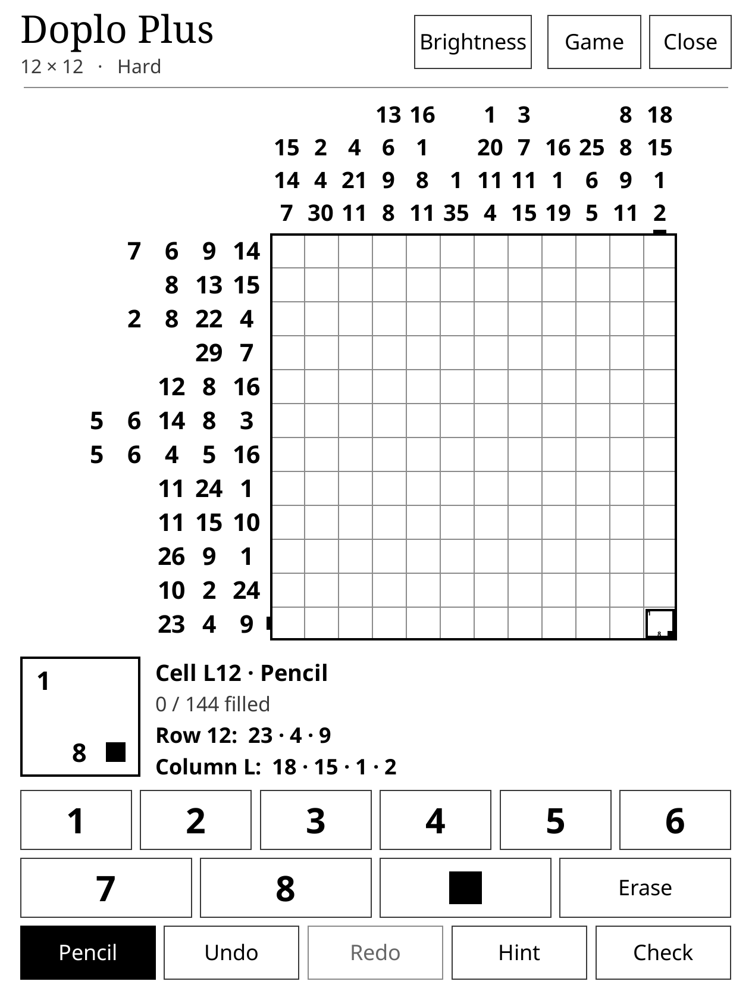
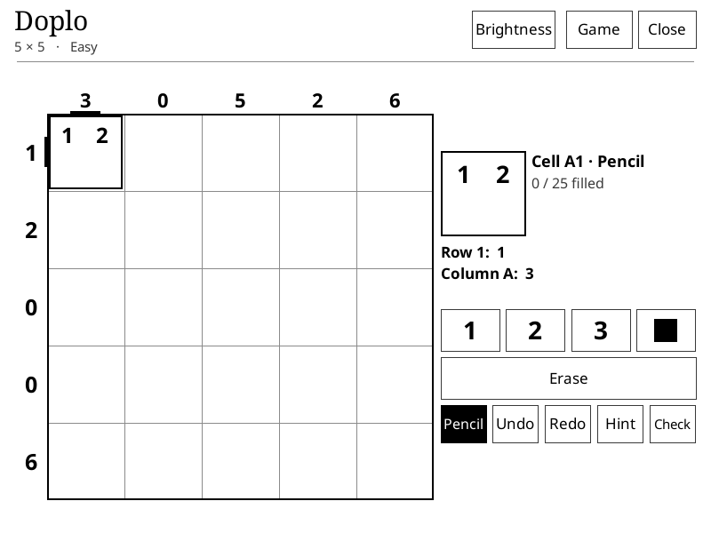
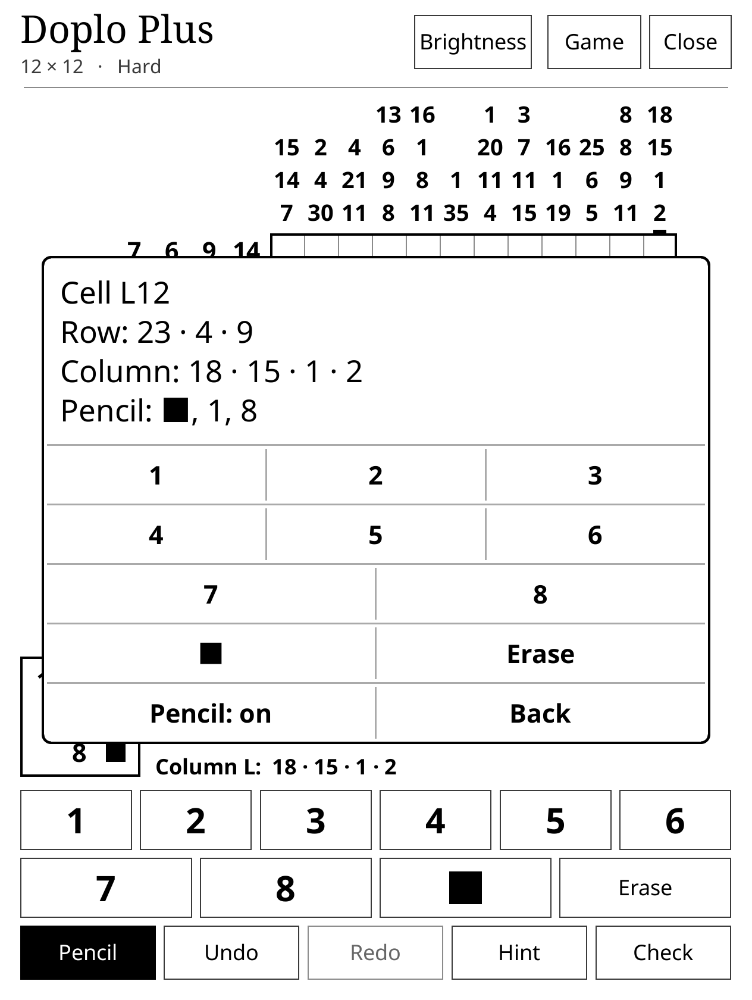

# Doplo for KOReader

Play Doplo and Doplo Plus offline on an e-reader running KOReader. **Tools → Doplo** immediately opens a 5×5 puzzle or resumes your last game. The plugin is written in Lua. Tap a cell and then a value to make a move.

## On a Kobo

Doplo Plus on a Kobo, at a desk and in low light. The low-light photo shows an earlier interface.

| At a desk | In low light |
| --- | --- |
|  |  |

## Installation

1. Close KOReader and connect your Kobo to your computer via USB.
2. Extract **doplo-v1.1.0.koplugin.zip** and copy the **doplo.koplugin** folder to **.adds/koreader/plugins/**. The full path on the Kobo is `.adds/koreader/plugins/doplo.koplugin/main.lua`. Enable hidden files in your file manager if the `.adds` folder is hidden.
3. Safely eject the Kobo. Start KOReader and open **Tools → Doplo** from the top menu. The menu is available in the file browser and while reading a book.

You can also copy the `doplo.koplugin` folder directly from this repository. For other KOReader installations, use the corresponding `plugins` folder. If Doplo was previously disabled, enable it under **Tools → More tools → Plugin management** and restart KOReader.

## Playing

| Action | Controls |
| --- | --- |
| Make a move | Tap a cell, then a digit or **■**. **Erase** clears an editable cell and its notes. Givens have a gray background and a dot in the corner. |
| Track candidates | Turn **Pencil** on. Tap a digit or block to add or remove a candidate. Turn **Pencil** off to enter a final value. |
| Read pencil marks | The enlarged detail cell shows all notes in the selected cell, with large row and column clues beside it. Tap the detail cell or hold a board cell to open the larger input dialog. The whole board stays visible. |
| Adjust brightness | **Brightness** opens KOReader's standard frontlight controls. The button appears on devices with adjustable lighting. |
| Start with an empty board | Under **Game → New puzzle**, choose a variant and size, then **Prefilled cells: Off** or **On**. This setting applies to every difficulty level and is remembered. The default is **Off**. Existing games keep their progress. |
| Move around the board | Tap the target cell. Page-turn buttons move the selection in reading order, wrapping at the beginning and end. These bindings apply while the game window is open. |
| Take back a move | **Undo** and **Redo** also preserve pencil marks. Making a new move clears the redo history. |
| Check the board | **Check** reports the first rule violation it finds. On a partially filled board, it can also identify an entry that rules out the unique solution. A full board is marked **Solved** only after all lines, sums and givens have been checked. |
| Use a hint | **Hint** shows a cell, value and explanation. **Place value** applies the move. If an entry conflicts with the clues, the hint directs you to **Check**. |
| View the solution | **Game → Show solution** opens a read-only view. **Return** takes you back to your own board. |
| Open another game | **Game → New puzzle** lets you choose the variant, size and difficulty. **Game → Saved puzzles** shows previous games, their progress and when they were last changed. |

## Screenshots

Captured from version 1.1.0 running in KOReader's Linux/SDL build. [Capture details and reproduction instructions](docs/screens/README.md)

| Doplo 5×5 | Doplo Plus 12×12 |
| --- | --- |
|  |  |

| Enlarged pencil marks | Landscape |
| --- | --- |
|  |  |

Tap the detail cell or hold a board cell to open the larger input dialog:



## Rules and sizes

Each row and column contains every allowed digit exactly once and the specified number of filled blocks.

| Variant | Size | Blocks | Digits | Edge clues |
| --- | --- | --- | --- | --- |
| Doplo | 5×5 | 2 | 1–3 | One sum between the two blocks |
| Doplo | 6×6 | 2 | 1–4 | One sum between the two blocks |
| Doplo | 7×7 | 2 | 1–5 | One sum between the two blocks |
| Doplo | 8×8 | 2 | 1–6 | One sum between the two blocks |
| Doplo Plus | 7×7 | 2 | 1–5 | One sum per uninterrupted run of digits |
| Doplo Plus | 8×8 | 2 | 1–6 | One sum per uninterrupted run of digits |
| Doplo Plus | 9×9 | 3 | 1–6 | One sum per uninterrupted run of digits |
| Doplo Plus | 10×10 | 3 | 1–7 | One sum per uninterrupted run of digits |
| Doplo Plus | 11×11 | 3 | 1–8 | One sum per uninterrupted run of digits |
| Doplo Plus · Extended | 12×12 | 4 | 1–8 | The same run sums on a larger grid |

In **Doplo**, `■ 1 2 3 ■` gives a clue of 6 and `1 ■ 2 3 ■` gives a clue of 5. Adjacent blocks give 0. [Publisher's Doplo rules](https://www.kueng-raetsel.ch/anleitungen/)

In **Doplo Plus**, read the digit runs from left to right or top to bottom. Runs touching an edge count too. The sequence `1 2 ■ 3 ■ 4 5` has clues **3 · 3 · 9**. The sequence `■ ■ 2 1 5 4 3` has only **15**. The publisher describes 7×7 and 10×10 puzzles. The plugin adds its own extensions: Plus 8×8 with two blocks, 9×9 and 11×11 with three blocks, and 12×12 with four blocks. Doplo 7×7 and 8×8 use the classic two-block rule. [Publisher's Doplo Plus rules, printed p. 40](https://www.kueng-raetsel.ch/hefte/Taschen-Logik-Mix.pdf#page=13)

## Generation, difficulty and storage

The generator creates a solution, derives its clues and may add givens only when **Prefilled cells: On** is selected. With **Off**, every cell starts empty. Empty puzzles are checked separately for uniqueness; the plugin does not simply remove the givens from an existing puzzle. The solver counts solutions until it finds a second one or exhausts the search space. Only a grid with exactly one solution and the requested difficulty is offered. The monochrome interface uses targeted refreshes for selection, values and controls.

With **Prefilled cells: On**, difficulty is based on simultaneous constraint propagation across all rows and columns. Only rounds that eliminate candidates count. Easy uses up to three rounds, Medium four or five, and Hard six to eight. Expert requires at least nine rounds or a branch in the search. This rating estimates difficulty from the solver's perspective. A player's experience may differ.

With **Off**, difficulty is graded separately for each variant and size. The score is the number of propagation rounds plus four times the base-2 logarithm of the number of search nodes. Thresholds are defined in `doplo/difficulty.lua`. This makes all four difficulty levels available without givens. An Easy puzzle on a large empty board may require more searching than a small Easy puzzle with givens.

Generation regularly yields control to KOReader. **Cancel** keeps your current game. **Play ready puzzle** immediately starts a previously verified puzzle at the selected size and difficulty. After about four seconds, or 80 attempts, Doplo automatically selects from the same bank. Each of the eighty combinations of variant, size, difficulty and starting mode has twelve verified puzzles: 960 in total. After twelve bank puzzles in the same combination, the cycle repeats. The generator can also create new puzzles.

After every value, note, undo and redo, Doplo saves progress to a separate file for each game. Storage alternates between two versions. When reopening a game, Doplo selects the newest readable, valid version. The selected cell and pencil mode are also saved when closing or suspending. To back up your games, copy `settings/doplo-games/` and `settings/doplo.lua` from the KOReader profile. On a typical Kobo installation, the profile is in `.adds/koreader/`.

## Development and verification

| Component | Location in the plugin |
| --- | --- |
| Menu registration, opening and resuming games | `main.lua` |
| Rules, validation and game state | `doplo/model.lua`, `doplo/game.lua` |
| Line analysis, search and hints | `doplo/line.lua`, `doplo/solver.lua` |
| Grid generation and difficulty rating | `doplo/generator.lua`, `doplo/difficulty.lua` |
| Verified puzzle bank | `doplo/bank.lua` |
| KOReader controls, layout and drawing | `doplo/screen.lua`, `doplo/layout.lua`, `doplo/paint.lua` |
| Storage and recovery | `doplo/store.lua` |

The decision procedure for a single line tracks the position, used digits and current sum or Plus run. It returns the possible values for each cell. The board solver intersects these possibilities from rows and columns, repeating until no more candidates are eliminated. If choices remain, it branches on the cell with the fewest candidates. Completed boards are checked by a separate implementation. The generator uses permutations of cyclic Latin squares, covering a subset of all valid completed grids.

Run these commands from the repository root to execute the tests and build the installation ZIP.

```sh
luajit tests/engine.lua
luajit tests/ui.lua
python3 tools/package.py --out /tmp/doplo-release
python3 tools/test_koreader.py /path/to/koreader --zip /tmp/doplo-release/doplo-v1.1.0.koplugin.zip
```

Version 1.1.0 passes all 17 engine test groups, checks of the full puzzle bank, controls using test doubles, and the native storage and installation tests on KOReader v2025.10 for Linux/SDL. The screenshots above were captured during that installation test. Refresh behavior on a physical e-ink panel and physical page-turn buttons still need device testing. The controls are designed for touch devices. Undo history retains the last 200 changes per puzzle. [Test instructions and results](docs/VERIFICATION.md)

## License

AGPL-3.0-or-later. All bundled puzzles come from the plugin's own generator. [Full license](LICENSE) · [Sources and reuse](doplo.koplugin/SOURCES.md)

## Git repository from the source ZIP

Alongside the extracted files, the source ZIP contains a Git bundle with the `main` branch and the `v1.0.0` release tag. From the extracted root folder, create a local clone with `git clone repository.bundle ../doplo-git`.
